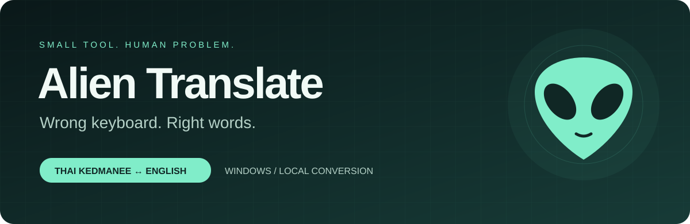
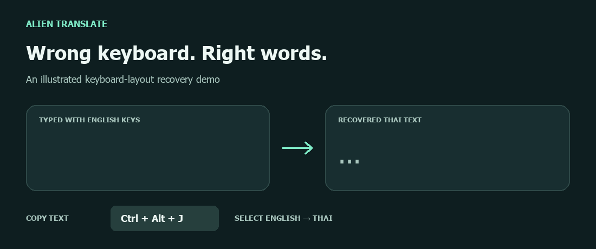

<div align="center">



**พิมพ์ผิดภาษา? เอาข้อความเดิมกลับมาได้ในไม่กี่คลิก 👽**

แปลงข้อความที่พิมพ์ผิดแป้น **ไทยเกษมณี ↔ อังกฤษ US QWERTY** บน Windows

[**ดาวน์โหลดสำหรับ Windows**](https://github.com/krispyroj/alien-translate/releases/latest) · [วิธีใช้](#วิธีใช้) · [Build จากซอร์ส](#build-จากซอร์ส)


[](LICENSE)
[](https://github.com/krispyroj/alien-translate/actions/workflows/build.yml)

</div>

## ลืมเปลี่ยนภาษา ไม่ต้องพิมพ์ใหม่

ตั้งใจพิมพ์ `สวัสดี` แต่ได้ `l;ylfu`? Alien Translate จับคู่ข้อความตามตำแหน่งปุ่มบนคีย์บอร์ด แล้วแสดงผลให้ใกล้เมาส์ ใช้งานจากไอคอนหัวเอเลี่ยนสีมิ้นต์ใน system tray ได้เลย



*ภาพสาธิตหลักการแปลงข้อความ ไม่ใช่ภาพหน้าจอของโปรแกรม*

| ข้อความที่พิมพ์ผิด | เลือกการแปลง | ผลลัพธ์ |
| --- | --- | --- |
| `l;ylfu` | อังกฤษ → ไทยเกษมณี | `สวัสดี` |
| `้ำสสน` | ไทยเกษมณี → อังกฤษ | `hello` |
| `L;YLFU` | แก้ Caps Lock · อังกฤษ → ไทย | `สวัสดี` |

## ทำอะไรได้บ้าง

- **คลุมข้อความแล้วคลิกขวา** เพื่อเลือกทิศทางการแปลง
- **คัดลอกแล้วกด `Ctrl+Alt+J`** ใช้กับข้อความที่แอปเปิดให้คัดลอกได้
- **แก้ข้อความที่เผลอเปิด Caps Lock** ทั้งตอนใช้แป้นไทยและอังกฤษ
- **ชี้ข้อความแล้วกด `Ctrl+Alt+H`** อ่านข้อความจากแอปที่รองรับ พร้อมปุ่มคัดลอกผล
- **ใช้งานกับ LINE** ผ่านคำสั่ง “คัดลอกข้อความที่เลือก”
- **แปลงในเครื่อง** ไม่ต้องสมัครบัญชี ไม่ต้องใช้ API key และไม่ส่งข้อความไปแปลบนเซิร์ฟเวอร์

นี่คือเครื่องมือแก้ข้อความที่พิมพ์ผิดแป้นตามตำแหน่งปุ่ม ไม่ใช่การแปลความหมายระหว่างภาษา

## ดาวน์โหลดและเปิดใช้

1. ไปที่ [Releases](https://github.com/krispyroj/alien-translate/releases/latest) แล้วดาวน์โหลด `AlienTranslate.exe`
2. เปิดไฟล์ได้เลย ไม่ต้องติดตั้ง แล้วมองหาไอคอนหัวเอเลี่ยนสีมิ้นต์ที่มุมขวาล่างของ Windows (อาจอยู่ในเมนูไอคอนที่ซ่อน)
3. คลุมข้อความที่พิมพ์ผิดแล้วคลิกขวา หรือคัดลอกข้อความแล้วกด `Ctrl+Alt+J`

ต้องใช้ Windows ที่มี .NET Framework 4.5 ขึ้นไปและ Windows Desktop components ใช้คีย์บอร์ดไทยเกษมณีและอังกฤษ US QWERTY รุ่นนี้ยังไม่มีลายเซ็นดิจิทัล (code signing)

## วิธีใช้

| สิ่งที่ต้องการ | วิธีทำ |
| --- | --- |
| แปลงข้อความที่เลือก | คลุมข้อความ → คลิกขวาบนข้อความ → เลือกทิศทางจากเมนู Alien Translate |
| แปลงจากคลิปบอร์ด | คัดลอกข้อความ → `Ctrl+Alt+J` → เลือกทิศทาง |
| แก้ Caps Lock | เลือกเฉพาะช่วงที่ผิด → เลือก “แก้ Caps Lock” ให้ตรงกับแป้นที่ใช้พิมพ์ |
| ใช้ใน LINE | คลุมข้อความ → คลิกขวา → “คัดลอกข้อความที่เลือก” → เมนูแปลงจะเปิดหลังคัดลอก |
| อ่านข้อความตรงที่ชี้ | วางเมาส์บนข้อความ → `Ctrl+Alt+H` → อ่านผลหรือกด “คัดลอกผล” |
| เปิดเฉพาะเมนูของแอปต้นทาง | กด `Shift` ค้างไว้ขณะคลิกขวา |
| เปิดเมนูโปรแกรม | คลิกขวาที่ไอคอนหัวเอเลี่ยนใน system tray |
| ปิดโปรแกรม | เลือก “ออกจากโปรแกรม” จากไอคอน system tray |

ผลการแปลงจากเมนูแสดงใกล้เมาส์ประมาณ 4.5–9 วินาที โปรแกรมไม่แทนที่ข้อความในแอปต้นทางอัตโนมัติ

### ถ้าเมนูไม่ขึ้น

การอ่านข้อความที่เลือกและข้อความตรงเมาส์อาศัย Windows UI Automation ซึ่งแต่ละแอปรองรับต่างกัน ลอง **คัดลอกข้อความแล้วกด `Ctrl+Alt+J`** หรือเลือก “แปลงข้อความที่คัดลอก” จากไอคอน system tray หากคีย์ลัดถูกโปรแกรมอื่นใช้อยู่ ให้ใช้เมนูจากไอคอนแทน

โปรแกรมไม่ได้ทำ OCR จากภาพ จึงไม่สามารถอ่านข้อความที่อยู่ในรูปภาพได้

## ข้อความและความเป็นส่วนตัว

ซอร์สโค้ดรุ่นนี้ไม่มีการเรียกเครือข่ายหรือบันทึกประวัติข้อความลงไฟล์ การแปลงเกิดในหน่วยความจำ โดยอ่านข้อความจากคลิปบอร์ดหรือ Windows UI Automation ตามวิธีที่ใช้ หากกด “คัดลอกผล” โปรแกรมจะเขียนผลลัพธ์ลงคลิปบอร์ดของ Windows

## Build จากซอร์ส

ใช้ Windows และ PowerShell พร้อม .NET Framework compiler (`csc.exe`) และ WPF UI Automation assemblies ไม่ต้องติดตั้ง NuGet packages

```powershell
git clone https://github.com/krispyroj/alien-translate.git
cd alien-translate
.\build.ps1
```

ผลลัพธ์อยู่ที่ `dist\AlienTranslate.exe` โดย `dist/` ไม่ถูกเก็บใน Git

รันชุดทดสอบการแปลงข้อความ:

```powershell
.\tests\test.ps1
```

GitHub Actions จะ build และทดสอบบน Windows เมื่อ push หรือเปิด pull request ดาวน์โหลดผล build ได้จาก artifact ของ workflow ส่วนไฟล์สำหรับผู้ใช้ทั่วไปอยู่ใน Releases

## โครงสร้างโปรเจกต์

```text
src/
  Program.cs           # System tray, hotkeys, menus, result window
  Kedmanee.cs          # Key-position mapping and Caps Lock correction
  ScreenText.cs        # Selected / pointed text via Windows UI Automation
  RightClickHook.cs    # Mouse hook
  LineCopyWatch.cs     # LINE clipboard integration
  PreviewWindow.cs     # Temporary result near the pointer
  AlienTranslate.ico   # Application icon
tests/                 # Conversion regression checks
docs/                  # README artwork and illustrated demo
build.ps1              # Build with the Windows .NET Framework compiler
```

## English

Alien Translate is a small Windows tray utility for recovering text typed with the wrong keyboard layout: Thai Kedmanee ↔ English US QWERTY. Select text and right-click, or copy it and press `Ctrl+Alt+J`. It also corrects Caps Lock mistakes. Conversion runs locally; it maps physical key positions rather than translating language meaning. Text selection support depends on the source application's Windows UI Automation support.

## License

[MIT](LICENSE) — นำไปใช้ แก้ไข และแจกจ่ายต่อได้ตามเงื่อนไขในไฟล์ License
